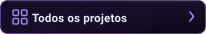

<!-- 1. Hero Principal · Awerkori & Project Nox -->
<picture>
  <source media="(max-width: 600px)" srcset="./assets/profile/hero-mobile.svg">
  
</picture>

 

  Desenvolvedor de software e fundador do
  <a href="https://github.com/ProjectNox-org"><strong>Project Nox</strong></a>
  — uma iniciativa de código aberto dedicada a plataformas digitais, ferramentas de automação e software para a comunidade.

  Os repositórios públicos, lançamentos e a documentação oficial estão centralizados na organização:

  
  
  

<!-- 2. Atividade do GitHub (atualização automática) -->
<picture>
  <source media="(max-width: 600px)" srcset="./assets/profile/activity-mobile.svg">
  
</picture>

<!-- 3. Mais sobre mim -->
<a href="https://zyo.se/awerkori">
  <picture>
    <source media="(max-width: 600px)" srcset="./assets/profile/card-about-mobile.svg">
    
  </picture>
</a>

 

✦ Awerkori · Project Nox ✦

