<!-- 1. Cabeçalho Oficial Project Nox (banner animado com feixe de luz e símbolo NΩΛ) -->
<picture>
  <source media="(max-width: 600px)" srcset="./assets/profile/hero-mobile.svg">
  
</picture>

 

<h3>Fundador &amp; Desenvolvedor Principal do <a href="https://github.com/ProjectNox-org">Project Nox</a></h3>

  Todos os meus principais projetos e repositórios foram consolidados na organização oficial
  <a href="https://github.com/ProjectNox-org"><strong>github.com/ProjectNox-org</strong></a>,
  onde o desenvolvimento segue ativo diariamente. 
  Para explorar o código-fonte, lançamentos, catálogos e automações, acesse diretamente a organização.

  <a href="https://github.com/ProjectNox-org"><strong>🏛️ Acessar a Organização Project Nox →</strong></a>
  &nbsp;·&nbsp;
  <a href="https://github.com/ProjectNox-org?tab=repositories"><strong>📦 Todos os Repositórios</strong></a>
  &nbsp;·&nbsp;
  <a href="https://projectnox-org.github.io/project-nox-tracker/"><strong>📊 Tracker Oficial</strong></a>

<!-- 2. Atividade do GitHub -->
<picture>
  <source media="(max-width: 600px)" srcset="./assets/profile/activity-mobile.svg">
  
</picture>

<!-- 3. Project Nox · Mangá -->
<a href="https://github.com/ProjectNox-org/manga-extensoes">
  <picture>
    <source media="(max-width: 600px)" srcset="./assets/profile/card-manga-mobile.svg">
    
  </picture>
</a>

   

<!-- 4. Project Nox · Anime -->
<a href="https://github.com/ProjectNox-org/anime-extensoes">
  <picture>
    <source media="(max-width: 600px)" srcset="./assets/profile/card-anime-mobile.svg">
    
  </picture>
</a>

   

<!-- 5. Project Nox · Tickets -->
<a href="https://projectnox-org.github.io/project-nox-tracker/">
  <picture>
    <source media="(max-width: 600px)" srcset="./assets/profile/card-tickets-mobile.svg">
    
  </picture>
</a>

   

<!-- 6. Project Nox · Plataforma & Infraestrutura -->
<a href="https://github.com/ProjectNox-org/project-nox-manga">
  <picture>
    <source media="(max-width: 600px)" srcset="./assets/profile/card-site-mobile.svg">
    
  </picture>
</a>

   

<h3>Ecossistema completo em <a href="https://github.com/ProjectNox-org">ProjectNox-org</a></h3>

| Frente | Repositórios oficiais |
| --- | --- |
| **Mangá** | [manga-extensoes](https://github.com/ProjectNox-org/manga-extensoes) · [manga-fonte-extensoes](https://github.com/ProjectNox-org/manga-fonte-extensoes) · [project-nox-manga](https://github.com/ProjectNox-org/project-nox-manga) · [project-nox-importer](https://github.com/ProjectNox-org/project-nox-importer) |
| **Anime** | [anime-extensoes](https://github.com/ProjectNox-org/anime-extensoes) · [anime-fonte-extensoes](https://github.com/ProjectNox-org/anime-fonte-extensoes) |
| **Comunidade &amp; Ferramentas** | [project-nox-requests](https://github.com/ProjectNox-org/project-nox-requests) · [project-nox-tracker](https://github.com/ProjectNox-org/project-nox-tracker) · [project-nox-scan-staff](https://github.com/ProjectNox-org/project-nox-scan-staff) · [nox-extension-developer](https://github.com/ProjectNox-org/nox-extension-developer) |

<!-- 7. Mais sobre mim -->
<a href="https://zyo.se/awerkori">
  <picture>
    <source media="(max-width: 600px)" srcset="./assets/profile/card-about-mobile.svg">
    
  </picture>
</a>

  <a href="https://github.com/ProjectNox-org"><b>Explorar a organização Project Nox no GitHub →</b></a>

✦ NΩΛ · Awerkori × Project Nox ✦

