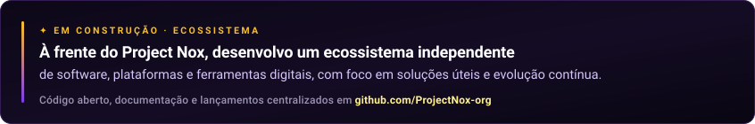
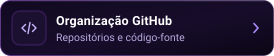
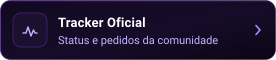

<!-- 1. Hero Principal · Awerkori & Project Nox -->
<picture>
  <source media="(max-width: 600px)" srcset="./assets/profile/hero-mobile.svg">
  
</picture>

<!-- 2. Apresentação Institucional & Pessoal -->
<picture>
  <source media="(max-width: 600px)" srcset="./assets/profile/card-intro-mobile.svg">
  
</picture>

<!-- 3. Navegação Principal -->

  
  
  

<!-- 4. Atividade do GitHub (atualização automática) -->
<picture>
  <source media="(max-width: 600px)" srcset="./assets/profile/activity-mobile.svg">
  
</picture>

<!-- 5. Mais sobre mim -->
<a href="https://zyo.se/awerkori">
  <picture>
    <source media="(max-width: 600px)" srcset="./assets/profile/card-about-mobile.svg">
    
  </picture>
</a>

 

✦ Awerkori · Project Nox ✦

