<div align="center">

<!-- 1. Cabeçalho Oficial Project Nox -->
<picture>
  <source media="(max-width: 600px)" srcset="./assets/profile/hero-mobile.svg">
  
</picture>


<!-- 2. Atividade do GitHub (Diretamente abaixo do cabeçalho) -->
<picture>
  <source media="(max-width: 600px)" srcset="./assets/profile/activity-mobile.svg">
  
</picture>


<!-- 3. Project Nox · Mangá -->
<a href="https://github.com/Awerkori/manga-extensoes">
  <picture>
    <source media="(max-width: 600px)" srcset="./assets/profile/card-manga-mobile.svg">
    
  </picture>
</a>
<p align="center">
  <a href="https://github.com/Awerkori/manga-extensoes"></a> <a href="https://github.com/Awerkori/manga-fonte-extensoes"></a>
</p>

<!-- 4. Project Nox · Anime -->
<a href="https://github.com/Awerkori/anime-extensoes">
  <picture>
    <source media="(max-width: 600px)" srcset="./assets/profile/card-anime-mobile.svg">
    
  </picture>
</a>
<p align="center">
  <a href="https://github.com/Awerkori/anime-extensoes"></a> <a href="https://github.com/Awerkori/anime-fonte-extensoes"></a>
</p>

<!-- 5. Project Nox · Tickets -->
<a href="https://awerkori.github.io/project-nox-tracker/">
  <picture>
    <source media="(max-width: 600px)" srcset="./assets/profile/card-tickets-mobile.svg">
    
  </picture>
</a>
<p align="center">
  <a href="https://awerkori.github.io/project-nox-tracker/"></a> <a href="https://github.com/Awerkori/project-nox-requests/issues/new/choose"></a>
</p>

<!-- 6. Project Nox · Site -->
<a href="https://manga.project-nox-awerkori.workers.dev">
  <picture>
    <source media="(max-width: 600px)" srcset="./assets/profile/card-site-mobile.svg">
    
  </picture>
</a>
<p align="center">
  <a href="https://manga.project-nox-awerkori.workers.dev"></a> <a href="https://github.com/Awerkori/project-nox-manga"></a>
</p>


<!-- 7. Mais sobre mim -->
<a href="https://zyo.se/awerkori">
  <picture>
    <source media="(max-width: 600px)" srcset="./assets/profile/card-about-mobile.svg">
    
  </picture>
</a>

<p align="center">
  <a href="https://github.com/Awerkori?tab=repositories"><b>Ver todos os repositórios públicos no GitHub →</b></a>
</p>

<sub>✦ NΩΛ · Awerkori × Project Nox ✦</sub>


---

## ⚖️ Licenciamento e Proteção de Marca

Os scripts de automação, arquivos de configuração e recursos vetoriais originais deste repositório são software livre licenciados sob a **GNU General Public License versão 3.0** (`GPL-3.0-only`). Consulte o arquivo [LICENSE](LICENSE) para obter o texto integral inalterado da licença e o arquivo [NOTICE](NOTICE) para o inventário de autoria e termos legais.

```
Copyright (C) 2026 Awerkori & Project Nox Contributors

This program is free software: you can redistribute it and/or modify
it under the terms of the GNU General Public License as published by
the Free Software Foundation, version 3 of the License.
```

### 🛡️ Preservação de Identidade e Autenticidade
A licença GPL 3.0 aplica-se exclusivamente aos direitos autorais do código e dos recursos abertos. Ela **não concede** direitos de uso da marca, do nome "Project Nox", da denominação "Awerkori" ou de logotipos oficiais para alegar afiliação, representação oficial ou endosso. É vedado utilizar esta identidade para se passar pelo titular ou pelo Project Nox.

### 📌 Nota sobre GPL-3.0 e AGPL-3.0
O repositório adota formalmente a licença **GNU GPL versão 3.0**, a qual não contém a cláusula de interação remota por rede (Seção 13 da AGPLv3).

</div>