<!-- 1. Cabeçalho Oficial Project Nox -->
<picture>
  <source media="(max-width: 600px)" srcset="./assets/profile/hero-mobile.svg">
  
</picture>

<!-- 2. Atividade do GitHub (Diretamente abaixo do cabeçalho) -->
<picture>
  <source media="(max-width: 600px)" srcset="./assets/profile/activity-mobile.svg">
  
</picture>

<!-- 3. Project Nox · Mangá -->
<a href="https://github.com/Awerkori/extensoes">
  <picture>
    <source media="(max-width: 600px)" srcset="./assets/profile/card-manga-mobile.svg">
    
  </picture>
</a>

  
  &nbsp;&nbsp;
  

<!-- 4. Project Nox · Anime -->
<a href="https://github.com/Awerkori/anime-extensoes">
  <picture>
    <source media="(max-width: 600px)" srcset="./assets/profile/card-anime-mobile.svg">
    
  </picture>
</a>

  
  &nbsp;&nbsp;
  

<!-- 5. Project Nox · Tickets -->
<a href="https://awerkori.github.io/project-nox-tracker/">
  <picture>
    <source media="(max-width: 600px)" srcset="./assets/profile/card-tickets-mobile.svg">
    
  </picture>
</a>

  
  &nbsp;&nbsp;
  

<!-- 6. Project Nox · Site -->
<a href="https://manga.project-nox-awerkori.workers.dev">
  <picture>
    <source media="(max-width: 600px)" srcset="./assets/profile/card-site-mobile.svg">
    
  </picture>
</a>

  
  &nbsp;&nbsp;
  

<!-- 7. Mais sobre mim -->
<a href="https://zyo.se/awerkori">
  <picture>
    <source media="(max-width: 600px)" srcset="./assets/profile/card-about-mobile.svg">
    
  </picture>
</a>

  <a href="https://github.com/Awerkori?tab=repositories"><b>Ver todos os repositórios públicos no GitHub →</b></a>

✦ NΩΛ · Awerkori × Project Nox ✦

