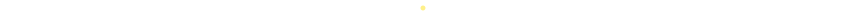
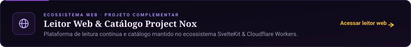

<picture>
  <source media="(max-width: 600px)" srcset="./assets/profile/hero-mobile.svg">
  
</picture>

<!-- Destaque Principal: Repositórios de Extensões -->
<a href="https://github.com/Awerkori/extensoes">
  <picture>
    <source media="(max-width: 600px)" srcset="./assets/profile/card-extensoes-manga-mobile.svg">
    
  </picture>
</a>

<a href="https://github.com/Awerkori/anime-extensoes">
  <picture>
    <source media="(max-width: 600px)" srcset="./assets/profile/card-extensoes-anime-mobile.svg">
    
  </picture>
</a>

<!-- Projeto Secundário: Leitor Web -->
<a href="https://manga.project-nox-awerkori.workers.dev">
  <picture>
    <source media="(max-width: 600px)" srcset="./assets/profile/card-site-manga-mobile.svg">
    
  </picture>
</a>

<!-- Atividade Real no GitHub -->
<picture>
  <source media="(max-width: 600px)" srcset="./assets/profile/activity-mobile.svg">
  
</picture>

<!-- Além do GitHub: Mais sobre mim -->
<a href="https://zyo.se/awerkori">
  <picture>
    <source media="(max-width: 600px)" srcset="./assets/profile/card-about-mobile.svg">
    
  </picture>
</a>

 

NΩΛ · Awerkori × Project Nox · Identidade Cósmica &amp; Ecossistema Aberto

